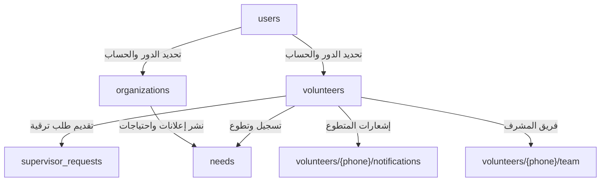

# 🗺️ دليل وهيكلية قاعدة بيانات Firestore — منصة المحروسة (MAHROUSA)

هذا الملف يحتوي على الدليل الشامل والمخطط المعماري لقاعدة بيانات Firestore الخاصة بمنصة وتطبيق **المحروسة (MAHROUSA)**، وهو موجه لمطور لوحة التحكم (Dashboard) لفهم بنية البيانات، المجموعات، الحقول، والعلاقات وسير العمل (Workflows) بما فيها الإشعارات والإعلانات الميدانية.

---

## 🏗️ نظرة عامة على المجموعات (Collections Map)



---

## 1️⃣ مجموعة المستخدمين: `users`
> **الهدف:** نقطة التحقق الأولى عند تسجيل الدخول لمعرفة نوع الحساب وحالته وصلاحياته.

* **مسار المجموعة:** `/users/{phoneNumber}`
* **معرّف الوثيقة (Document ID):** رقم الهاتف (مثال: `0557205095` أو `+213557205095`)

### جدول الحقول:
| الحقل (Field) | النوع (Type) | الوصف والقيم المحتملة |
| :--- | :--- | :--- |
| `role` | `string` | دور الحساب: `"volunteer"` (متطوع) أو `"organization"` (جمعية/منظمة) |
| `isSupervisor` | `boolean` | هل المتطوع مشرف معتمد؟ (`true` / `false`) |
| `hasPendingUpgrade` | `boolean` | هل لديه طلب ترقية لمشرف قيد الدراسة؟ (`true` / `false`) |
| `supervisorResources`| `map / object` | الموارد المعتمدة للمشرف (النوع، السعة، الموقع، التفرغ) |
| `createdAt` | `timestamp` | تاريخ إنشاء الحساب (`serverTimestamp()`) |

---

## 2️⃣ مجموعة المتطوعين: `volunteers`
> **الهدف:** تخزين الملف الشخصي والبيانات التفصيلية لكل متطوع.

* **مسار المجموعة:** `/volunteers/{phoneNumber}`
* **معرّف الوثيقة (Document ID):** رقم الهاتف (مثال: `0557205095`)

### جدول الحقول:
| الحقل (Field) | النوع (Type) | الوصف والقيم المحتملة |
| :--- | :--- | :--- |
| `fullName` | `string` | الاسم الكامل للمتطوع |
| `phoneNumber` | `string` | رقم الهاتف الأساسي |
| `role` | `string` | القيمة دائماً `"volunteer"` |
| `wilaya` | `string` | كود الولاية (من `"01"` إلى `"69"`) |
| `commune` | `string` | اسم أو كود البلدية |
| `skill` | `string` | مهارة/تخصص المتطوع: (`"medical"`, `"logistics"`, `"construction"`, `"cooking"`, `"teaching"`, `"driving"`, `"other"`) |
| `isSupervisor` | `boolean` | هل يملك رتبة مشرف؟ |
| `hasPendingUpgrade` | `boolean` | هل لديه طلب ترقية قيد الانتظار؟ |
| `supervisorResources`| `map / object` | تفاصيل الموارد إن كان مشرفاً |
| `createdAt` | `timestamp` | تاريخ التسجيل |

### 📂 1. مجموعة فرعية لأعضاء الفريق: `/volunteers/{phoneNumber}/team/{memberId}`
* **`name`** (`string`): اسم عضو الفريق.
* **`phone`** (`string`): رقم هاتف العضو.
* **`role`** (`string`): دور العضو في الفريق (مثال: `"سائق / نقل"`, `"مساعد لوجستي"`, إلخ).
* **`status`** (`string`): حالة التوافر (`"متاح"`).
* **`createdAt`** (`timestamp`): تاريخ الإضافة إلى الفريق.

### 🔔 2. مجموعة فرعية للإشعارات داخل التطبيق: `/volunteers/{phoneNumber}/notifications/{notificationId}`
> **الهدف:** إرسال واستقبال الإشعارات والتنبيهات المباشرة للمتطوع (يظهر عدد غير المقروء منها كـ Badge فوق أيقونة الجرس في الصفحة الرئيسية).

| الحقل (Field) | النوع (Type) | الوصف |
| :--- | :--- | :--- |
| `title` | `string` | عنوان الإشعار (مثال: "تهانينا! تمت ترقيتك إلى مشرف معتمد 🌟") |
| `body` | `string` | نص الإشعار بالتفصيل |
| `type` | `string` | نوع الإشعار: <br>• `"supervisor_upgrade_approved"`: قبول ترقية المشرف.<br>• `"supervisor_upgrade_rejected"`: رفض طلب الترقية.<br>• `"backup_promoted"`: ترقية من قائمة الاحتياط إلى الأساسي.<br>• `"attendance_reminder"`: تذكير تأكيد الحضور الميداني خلال مهلة الساعة.<br>• `"urgent_need"`: نداء استغاثة أو أزمة عاجلة.<br>• `"system"`: إشعار عام من المنصة. |
| `isRead` | `boolean` | هل قرأ المتطوع الإشعار؟ (`false` للإشعارات الجديدة، `true` عند الفتح). |
| `data` | `map / object` | بيانات إضافية للتوجيه التلقائي داخل التطبيق: <br>`{ needId: "...", screen: "SupervisorDashboard" \| "NeedDetails" }` |
| `createdAt` | `timestamp` | وقت وتاريخ إرسال الإشعار (`serverTimestamp()`). |

---

## 3️⃣ مجموعة الجمعيات والمنظمات: `organizations`
> **الهدف:** إدارة الجمعيات المسجلة، التحقق من وثائقها واعتمادها من الـ Dashboard.

* **مسار المجموعة:** `/organizations/{phoneNumber}`
* **معرّف الوثيقة (Document ID):** رقم هاتف الحساب (مثال: `0557205095`)

### جدول الحقول:
| الحقل (Field) | النوع (Type) | الوصف والقيم المحتملة |
| :--- | :--- | :--- |
| `fullName` / `organizationName` | `string` | الاسم الرسمي للجمعية أو المنظمة |
| `phoneNumber` | `string` | رقم هاتف الحساب |
| `role` | `string` | القيمة دائماً `"organization"` |
| `orgType` | `string` | نوع المنظمة: (`"charity"` جمعية خيرية, `"red_crescent"` الهلال الأحمر, `"youth_club"` نادي شبابي, `"sports_club"` نادي رياضي, `"municipality"` إدارة بلدية, `"other"` أخرى) |
| `legalNumber` | `string` | رقم الاعتماد القانوني / رقم التسجيل |
| `wilaya` | `string` | كود الولاية المقر (من `"01"` إلى `"69"`) |
| `commune` | `string` | البلدية المقر |
| `managerName` / `repName` | `string` | اسم ممثل / رئيس الجمعية |
| `managerPhone` / `repPhone`| `string` | رقم هاتف الممثل |
| `status` | `string` | **حالة الحساب:** <br>• `"pending"`: قيد مراجعة الإدارة (لا يمكنها الدخول للتطبيق). <br>• `"approved"`: تم القبول والاعتماد (يمكنها تسجيل الدخول ونشر الاحتياجات). <br>• `"rejected"`: تم رفض الطلب. |
| `createdAt` | `timestamp` | تاريخ تقديم طلب الانضمام |

> 📌 **إجراء لوحة التحكم للقبول:**
> ```javascript
> await updateDoc(doc(db, "organizations", phoneNumber), {
>   status: "approved"
> });
> ```

---

## 4️⃣ مجموعة طلبات الترقية إلى مشرف: `supervisor_requests`
> **الهدف:** استقبال ودراسة طلبات المتطوعين الذين يملكون موارد إضافية (شاحنات، مستودعات، آليات).

* **مسار المجموعة:** `/supervisor_requests/{phoneNumber}`
* **معرّف الوثيقة (Document ID):** رقم هاتف المتطوع مقدم الطلب.

### جدول الحقول:
| الحقل (Field) | النوع (Type) | الوصف |
| :--- | :--- | :--- |
| `phoneNumber` | `string` | رقم هاتف المتطوع |
| `resources` | `array of strings` | قائمة الموارد المقدمة (مثال: `["شاحنة ثقيلة (أكثر من 3 طن)", "مقر تخزين (مستودع)"]`) |
| `capacity` | `string` | تفاصيل وسعة المورد (مثال: `"شاحنة تبريد 10 طن"`) |
| `wilaya` | `string` | كود ولاية تواجد المورد |
| `commune` | `string` | بلدية تواجد المورد |
| `availabilityDays` | `array of strings` | أيام التفرغ (مثال: `["السبت", "الأحد", "الثلاثاء"]`) |
| `availabilityTime` | `string` | وقت التفرغ: (`"صباح"`, `"مساء"`, `"كل اليوم"`) |
| `status` | `string` | حالة الطلب: (`"pending"` قيد الانتظار, `"approved"` مقبول, `"rejected"` مرفوض) |
| `createdAt` | `timestamp` | تاريخ تقديم الطلب |

> 📌 **إجراء لوحة التحكم الموصى به عند قبول المشرف (`approved`):**
> ```javascript
> import { doc, updateDoc, collection, addDoc, serverTimestamp } from "firebase/firestore";
> 
> // 1. تحديث حالة الطلب
> await updateDoc(doc(db, "supervisor_requests", phoneNumber), {
>   status: "approved"
> });
> 
> // 2. ترقية حساب المستخدم
> await updateDoc(doc(db, "users", phoneNumber), {
>   isSupervisor: true,
>   hasPendingUpgrade: false
> });
> 
> // 3. ترقية ملف المتطوع
> await updateDoc(doc(db, "volunteers", phoneNumber), {
>   isSupervisor: true,
>   hasPendingUpgrade: false
> });
> 
> // 4. إرسال إشعار داخل التطبيق للمتطوع (يظهر له مباشرة كإشعار وإعلان في الرئيسية)
> await addDoc(collection(db, "volunteers", phoneNumber, "notifications"), {
>   title: "تهانينا! تمت ترقيتك إلى مشرف معتمد 🌟",
>   body: "تمت الموافقة على طلب ترقيتك بنجاح من طرف إدارة المنصة. يمكنك الآن فتح لوحة تحكم المشرف وإدارة فريقك ومواردك اللوجستية.",
>   type: "supervisor_upgrade_approved",
>   isRead: false,
>   data: {
>     screen: "SupervisorDashboard"
>   },
>   createdAt: serverTimestamp()
> });
> ```

---

## 5️⃣ مجموعة الاحتياجات والإعلانات: `needs`
> **الهدف:** الاحتياجات الميدانية والإغاثية المنشورة من طرف الجمعيات والتي يشارك فيها المتطوعون.

* **مسار المجموعة:** `/needs/{needId}`
* **معرّف الوثيقة (Document ID):** Auto-generated ID (تلقائي من Firestore)

### جدول الحقول:
| الحقل (Field) | النوع (Type) | الوصف |
| :--- | :--- | :--- |
| `title` | `string` | عنوان المهمة / الاحتياج (مثال: "توزيع طرود غذائية للمتضررين") |
| `needType` | `string` | نوع الاحتياج: (`"يد عاملة"`, `"شاحنة"`, `"مقر تخزين"`, `"خبرة"`) |
| `quantity` | `number` | العدد المطلوب من المتطوعين أو الموارد |
| `volunteersCount` | `number` | العدد الحالي للمتطوعين المسجلين بالمهمة |
| `volunteers` | `array of strings` | مصفوفة تحتوي على أرقام هواتف/معرّفات المتطوعين الأساسيين المنضمين |
| `backupVolunteers` | `array of strings` | **قائمة الاحتياط:** مصفوفة تحتوي على هواتف المتطوعين الاحتياطيين بالترتيب (FIFO) عند اكتمال العدد المطلوب |
| `volunteerRegisteredAt` | `map / object` | خريطة تسجل وقت انضمام كل متطوع أساسي `{ [phoneNumber]: timestampInMs }` لحساب مهلة الساعة |
| `completedVolunteers` | `array of strings` | مصفوفة هواتف المتطوعين الذين أنهوا المهمة |
| `confirmedAttendance` | `array of strings` | مصفوفة هواتف المتطوعين الذين أكدوا حضورهم الميداني |
| `wilaya` | `string` | كود ولاية الانطلاق/المهمة (مثال: `"16"`) |
| `wilayaName` | `string` | اسم ولاية الانطلاق (مثال: `"الجزائر"`) |
| `locationDetails` | `string` | العنوان التفصيلي أو البلدية |
| `coordinates` | `map / null` | إحداثيات الموقع `{ lat: number, lng: number }` |
| `destinationWilaya` | `string` | كود ولاية الوصول (اختياري في حالة نقل الشحنات) |
| `destinationWilayaName` | `string` | اسم ولاية الوصول (اختياري) |
| `destinationDetails` | `string` | تفاصيل موقع الوصول (اختياري) |
| `destinationCoordinates`| `map / null` | إحداثيات موقع الوصول `{ lat: number, lng: number }` |
| `startDate` | `string` | تاريخ البداية بصيغة `YYYY-MM-DD` |
| `endDate` | `string` | تاريخ النهاية بصيغة `YYYY-MM-DD` |
| `priority` | `string` | درجة الأولوية: (`"urgent"` عاجل 🔴, `"medium"` متوسط 🟡, `"normal"` عادي 🟢) |
| `description` | `string` | الشرح والتعليمات التفصيلية للمهمة |
| `organizationId` | `string` | رقم هاتف أو معرّف الجمعية صاحبة الإعلان |
| `organizationName` | `string` | اسم الجمعية المعلنة |
| `organizationPhone` | `string` | رقم هاتف التواصل مع مسؤولي المهمة |
| `status` | `string` | حالة الاحتياج: (`"active"` نشط, `"completed"` مكتمل, `"cancelled"` ملغى) |
| `createdAt` | `timestamp` | تاريخ النشر (`serverTimestamp()`) |

---

## ⚡ آلية القائمة الاحتياطية ومهلة الساعة (1-Hour Backup Auto-Promotion Workflow):

1. **عند اكتمال العدد (`volunteers.length >= quantity`):**
   * لا يُقفل التسجيل، بل يُتاح للمتطوعين خيار **"تسجيل كمتطوع احتياطي"**.
   * يُضاف المتطوع إلى مصفوفة `backupVolunteers`.

2. **مهلة تأكيد الحضور (1 ساعة):**
   * كل متطوع أساسي يُسجّل في `volunteers` يتم تسجيل وقت انضمامه في `volunteerRegisteredAt[phone] = Date.now()`.
   * يُمنح مهلة **ساعة واحدة (60 دقيقة)** لتأكيد حضوره وإدراجه في `confirmedAttendance`.

3. **الاستبدال التلقائي:**
   * إذا انقضت مهلة الساعة دون تأكيد الحضور، أو قام المتطوع الأساسي بالاعتذار/الإلغاء:
     * يُحذف المتطوع غير المؤكد من `volunteers`.
     * يتم ترقية أول متطوع من `backupVolunteers` (رأس القائمة) فوراً إلى `volunteers` مع بدء مهلة جديدة لساعة واحدة له.
     * يُرسل إشعار داخل التطبيق للمتطوع المرقّى لتنبيهه بتأكيد الحضور.

---

## 📢 آلية إعلانات الصفحة الرئيسية (Dynamic Home Announcements):
تتولد بنرات الإعلانات العلوية في الصفحة الرئيسية للمتطوع تلقائياً بناءً على الأحداث الحقيقية التالية:
1. **قبول ترقية المشرف:** يظهر بنر احتفالي بموافقة الترقية مع زر سريع ينقله إلى لوحة تحكم المشرف.
2. **الأزمات والاحتياجات العاجلة:** يظهر بنر أحمر نابض للأولويات القصوى (`priority: "urgent"`) لتشجيع الاستجابة الفورية.
3. **تنبيهات تأكيد الحضور / الترقية من الاحتياط:** يظهر بنر تحذيري بالمهلة المتبقية لتأكيد الحضور الميداني وتجنب الاستبدال.
